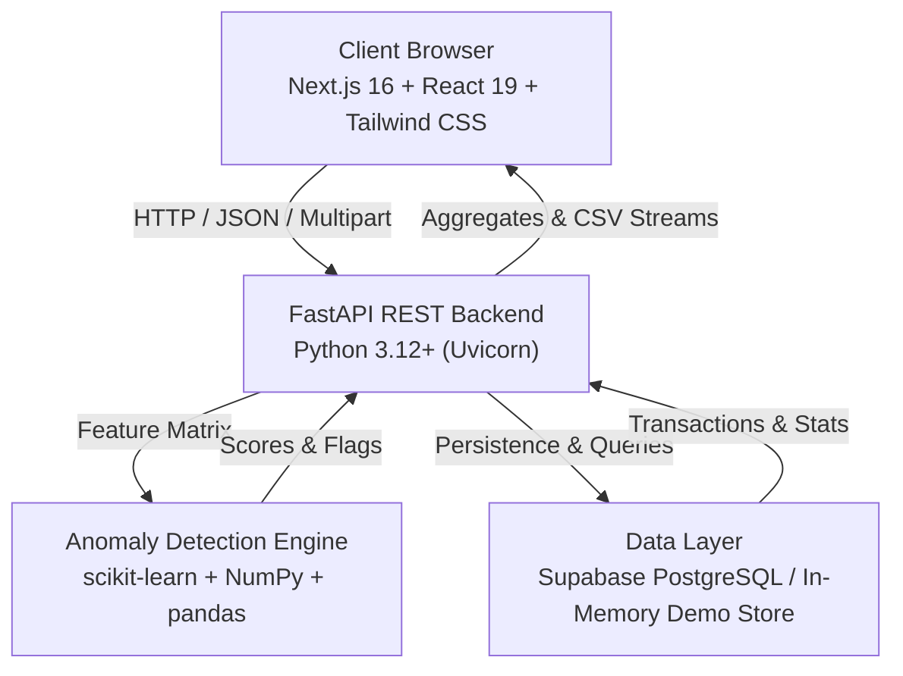

# SpendSense — System Architecture & Design

SpendSense is a financial transaction anomaly detection platform designed for personal finance audit, enterprise expense tracking, and fraud surveillance.

---

## 1. High-Level Architecture

---

## 2. Frontend Architecture

- **Framework**: Next.js 16 (App Router) with React 19 and TypeScript.
- **Styling**: Tailwind CSS with custom glassmorphism design tokens, CSS variables, dark-mode first palette, responsive typography.
- **State Management**: React Context (`AppContext`) orchestrating dataset selection, analysis execution, transaction pagination/filtering, review actions, and reactive dashboard synchronization.
- **Components**:
  - `Sidebar.tsx`: Dynamic tab router, status indicators, demo mode badge.
  - `Dashboard.tsx`: KPI cards (animated, color-coded), Recharts area charts (spend over time), pie charts (category anomaly distribution), bar charts (score distribution).
  - `UploadSection.tsx`: Drag-and-drop CSV uploader with client validation preview, auto column matching, error/warning toasts, sample data quick-loader.
  - `AnalysisSection.tsx`: Machine learning algorithm configuration (Isolation Forest, Statistical IQR, Combined ensemble), parameter sliders (contamination, estimators), real-time progress, ML disclaimer.
  - `TransactionTable.tsx`: TanStack Table v8 with multi-column sorting, debounced search, anomaly/review filters, row detail drawer, exclude/restore actions, status dropdowns.
  - `ReviewHistory.tsx`: Audit trail displaying user review events, status changes, timestamps, and justification notes.
  - `ExportsSection.tsx`: One-click CSV exports with scope filtering (all, included, flagged, excluded, review audit logs).

---

## 3. Machine Learning Detection Engine

### A. Feature Engineering Pipeline
The `AnomalyDetector` class transforms raw transaction rows into normalized numerical matrices:
1. **Numeric Features**:
   - `amount`: Raw signed transaction value.
   - `amount_abs`: Absolute transaction magnitude.
   - `amount_log`: Logarithmic scaling ($\ln(1 + |amount|)$) to handle fat-tailed financial distributions.
   - `amount_zscore`: Standard score deviations from the mean amount.
2. **Temporal Features**:
   - `day_of_week` (0–6), `day_of_month` (1–31), `hour` (0–23), `month` (1–12).
3. **Categorical Encodings**:
   - `category_encoded`, `transaction_type_encoded`, `merchant_encoded`, `account_encoded` using scikit-learn `LabelEncoder`.
4. **Feature Normalization**:
   - Standardized using `StandardScaler` to zero mean and unit variance.

### B. Detection Algorithms
1. **Isolation Forest (`IsolationForest`)**:
   - Unsupervised tree ensemble isolating observations by recursively partitioning random feature splits.
   - Anomalies require fewer splits (shorter path lengths) to isolate.
   - Decision function scores are mapped into a standardized $[0, 1]$ interval where 1 represents highest anomaly likelihood.
2. **Statistical IQR (Interquartile Range)**:
   - Evaluates spending against robust percentile spreads:
     $$IQR = Q_3 - Q_1$$
     $$\text{Lower Bound} = Q_1 - k \times IQR$$
     $$\text{Upper Bound} = Q_3 + k \times IQR$$
     (default $k = 1.5$).
   - Flags transactions exceeding boundaries with normalized outlier distance scoring.
3. **Combined Ensemble**:
   - Flags transactions identified by either method ($IF \lor IQR$).
   - Computes an ensemble confidence score:
     $$\text{Score}_{\text{combined}} = \frac{\text{Score}_{IF} + \text{Score}_{IQR}}{2}$$

---

## 4. Data Layer & Dual Storage Strategy

1. **Production Mode (Supabase / PostgreSQL)**:
   - Relational database schema with UUID primary keys, foreign key constraints, indexes on anomaly scores and review states.
   - Row-Level Security (RLS) policies configured for multi-tenant isolation.
2. **Demo Mode (In-Memory)**:
   - Automatic fallback when Supabase credentials are absent.
   - Fully functional in-memory storage (`DataManager`) supporting dataset upload, transaction pagination, updates, and CSV exports without external dependencies.
